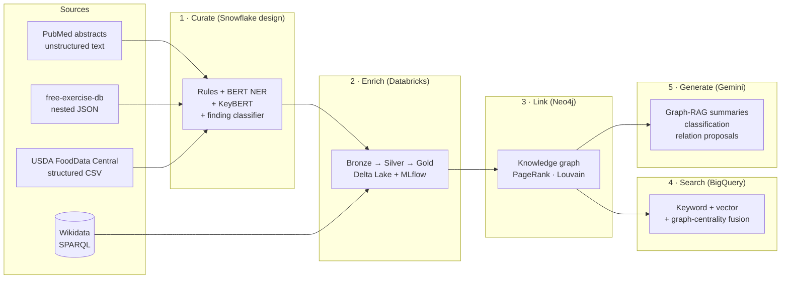
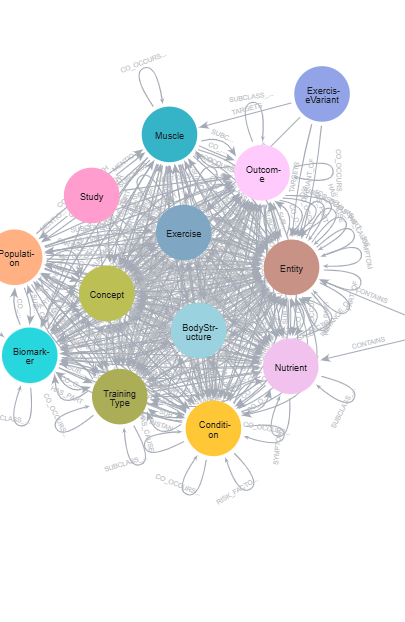
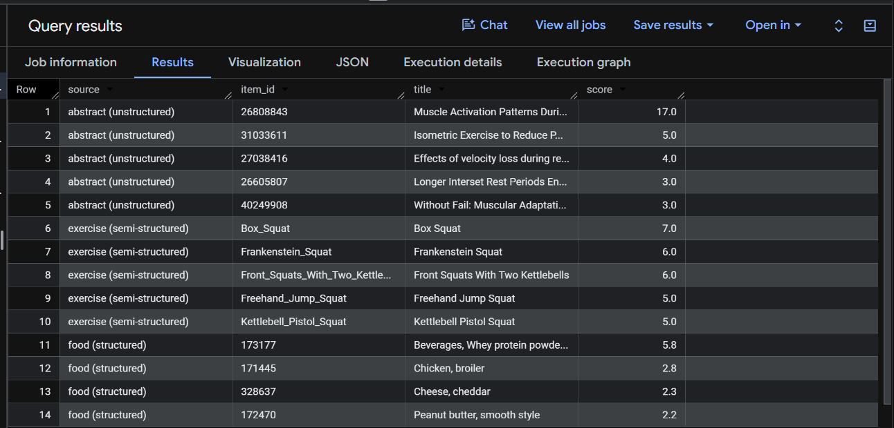
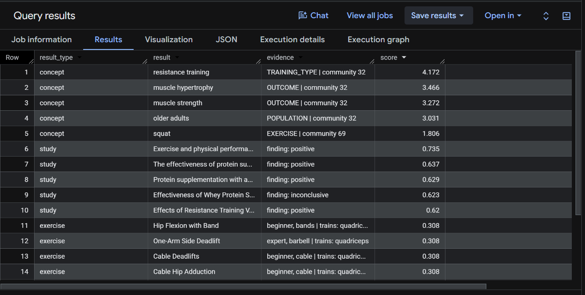

# Fitness & Health Knowledge Lake

A big-data **knowledge lake** for evidence-based fitness and health. It brings together research papers, an exercise database and nutrition data, then curates, enriches and links them into a knowledge graph. That graph is searchable across all three data shapes and is used to **ground an LLM** so that its answers cite real studies.

**Stack:** Python · Snowflake (SQL design) · Databricks (Delta Lake, MLflow) · Neo4j + Graph Data Science · Google BigQuery · Wikidata (SPARQL) · Hugging Face Transformers · Sentence-BERT · Google Gemini

---

## Results at a glance

| What | Result |
|---|---|
| Entity extraction | **129** typed entities and **2,192** study–entity links from **392** PubMed abstracts (391/392 abstracts covered) |
| Entity linking | **93 %** of entities linked to Wikidata, adding **704** external relations |
| Knowledge graph | **1,924 nodes**, **6,318 relationships** in Neo4j |
| Graph analytics | PageRank found the central concepts; Louvain found **3 research themes** with no labels: metabolic health, athletic performance, muscle & ageing |
| Search (BigQuery) | Hybrid keyword + vector search found **28 / 40** relevant studies (P@10 **0.70**, R@10 **0.80**), against 18 for keyword search |
| Grounded LLM (Graph-RAG) | **100 %** of cited studies traceable, against **12 %** without the graph |
| LLM classification of findings | **90 %** accuracy (macro-F1 **0.85**), against 60 % for a zero-shot BART model |

### Retrieval evaluation (relevant results in the top 10, 4 test questions)

| Method | Relevant / 40 | Precision@10 | Recall@10 |
|---|---|---|---|
| Keyword, natural-language question | 0 | 0.00 | 0.00 |
| Keyword, expert terms | 18 | 0.45 | 0.51 |
| Semantic (`VECTOR_SEARCH`) | 22 | 0.55 | 0.63 |
| **Hybrid (Reciprocal Rank Fusion)** | **28** | **0.70** | **0.80** |

---

## Architecture



1. **Curate:** ingest the three sources and extract entities with a hybrid of a rule-based gazetteer (331 synonyms), biomedical BERT NER, KeyBERT keywords and a study-finding classifier. Designed as a Snowflake pipeline (`sql/snowflake_pipeline.sql`: Snowpipe, Streams + Tasks, `LATERAL FLATTEN`, Cortex `AI_EXTRACT` / `AI_CLASSIFY`) and run in Python (`src/curate.py`) on the full dataset.
2. **Enrich:** a Databricks medallion workflow links each entity to Wikidata with type-aware candidate scoring, pulls descriptions, MeSH IDs and relations in one batched SPARQL query, applies a reviewed `MERGE` correction, and tracks every run in MLflow.
3. **Link:** load the gold tables into Neo4j, then run PageRank and Louvain with GDS (or the NetworkX fallback in `src/graph_algorithms.py`) and write the scores back to the nodes.
4. **Search:** federated BigQuery search across text, nested JSON and tables, fusing `SEARCH()`, `VECTOR_SEARCH` over 384-d MiniLM embeddings, and Neo4j PageRank.
5. **Generate:** Gemini (temperature 0.2) runs three measurable tasks on graph data: grounded summaries that cite PMIDs, finding classification against a labelled set, and proposals for new typed relations, which are written back as `pending_review` so a person approves them.

<p align="center">
  
</p>

| Federated search across three data shapes | Hybrid ranking with knowledge-graph centrality |
|---|---|
|  |  |

---

## Repository structure

```
src/
  fetch_data.py          # 1. download PubMed, free-exercise-db and USDA data -> data/
  curate.py              # 2. hybrid entity extraction -> curated/
  wikidata_enrich.py     # 3. Wikidata entity linking + SPARQL enrichment (local version)
  load_neo4j.py          # 4. load neo4j/nodes.csv + edges.csv into Neo4j
  graph_algorithms.py    #    PageRank / Louvain / betweenness with NetworkX (if GDS is unavailable)
  prepare_bigquery.py    # 5. build BigQuery upload files + MiniLM embeddings -> bigquery/
  genai_tasks.py         # 6. Gemini Graph-RAG, classification and relation proposals -> genai/
databricks/
  enrichment_notebook.py # Databricks notebook: Bronze -> Silver -> Gold + MLflow (also runs locally with PySpark)
sql/
  snowflake_pipeline.sql # Snowflake curation pipeline design
  bigquery_search.sql    # federated keyword / vector / hybrid search + evaluation
cypher/
  neo4j_queries.cypher   # GDS projections, PageRank, Louvain and example multi-hop queries
curated/  neo4j/  genai/  # outputs from the last run, so results can be checked without re-running
docs/images/             # screenshots
```

Raw PubMed abstracts are **not** included, because publishers may hold copyright in them. Run `src/fetch_data.py` to download them yourself.

---

## Running it

Requires Python 3.10+. Run every script from the repository root.

```bash
pip install -r requirements.txt
```

Set these environment variables (see `.env.example`). On Windows use `set NAME=value`; on macOS or Linux use `export NAME=value`.

| Variable | Used by | Notes |
|---|---|---|
| `NCBI_EMAIL` | `fetch_data.py` | NCBI asks API users to identify themselves |
| `USDA_API_KEY` | `fetch_data.py` | free at https://fdc.nal.usda.gov/api-key-signup (`DEMO_KEY` works for a few calls) |
| `GEMINI_API_KEY` | `genai_tasks.py` | free at https://aistudio.google.com/apikey (you're prompted if it isn't set) |

```bash
python src/fetch_data.py          # ~2-3 min
python src/curate.py              # ~10-15 min on CPU (first run downloads the models); --fast = rules only
python databricks/enrichment_notebook.py   # or import it into Databricks; writes neo4j/nodes.csv + edges.csv
python src/load_neo4j.py          # Neo4j Desktop running locally; asks for the password
#   then run cypher/neo4j_queries.cypher in Neo4j Browser (GDS), or: python src/graph_algorithms.py
python src/prepare_bigquery.py    # upload bigquery/* to a BigQuery dataset named knowledge_lake,
#   then run sql/bigquery_search.sql
python src/genai_tasks.py         # Gemini tasks; results in genai/
```

---

## Data sources

- **PubMed** via NCBI E-utilities: 392 abstracts across 10 fitness and health topics, 2015–2026
- **free-exercise-db** (GitHub, public domain): 876 exercises with muscles, equipment and level
- **USDA FoodData Central** (public domain): nutrient profiles for 30 foods
- **Wikidata** (CC0): entity linking and external relations

## About

Built by **Bimarsh Shrestha** for COMP8210 Big Data Technologies at Macquarie University (2026), and published with the unit convenor's permission. The assessment report itself is not included.

- Portfolio: https://bimarshshrestha.com.np
- LinkedIn: https://www.linkedin.com/in/bimarsh-shrestha-0aa9bb2b5/

Code is released under the MIT License. Third-party data keeps its original licence.
